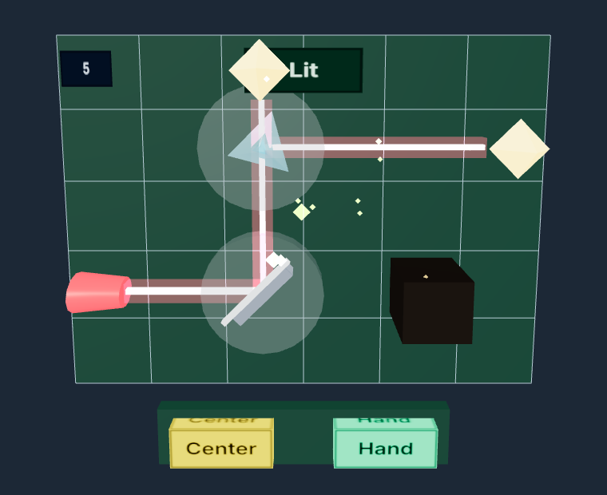

# Beamline

A seated mixed-reality laser puzzle for the Meta Quest Browser. Pinch a mirror or a prism and twist it in 15° steps until every crystal is lit.

Hands only. Controllers are not used. The emulator starts in hands mode. The board sits centered, about 40cm in front of your eyes and 15cm below them, tilted like a tray table so the whole board, including **Center** and **Hand**, stays in view. There are no spatial anchors. **Center** on the near edge puts it back in front of you. **Hand** on that same edge toggles the Hand Mirror. Progress (level and angles) is saved on rotation and survives exit/re-enter and reload. `beamline:progress` in `localStorage` is `{ v: 1, level, angles }` with a 1-based level. First XR entry shows a 3-card tutorial (Next / Got it), stored in `localStorage` `'beamline:tutorial'`.

## Play

Live WebXR build: [https://arunkumar-rmkec.github.io/beamline/](https://arunkumar-rmkec.github.io/beamline/)



### Controls (Hands-only, Seated)

- **Poke**: Push buttons with your index finger.
- **Pinch to Grab**: Pinch a mirror or prism with thumb and index finger to grab it.
- **Twist to Rotate**: Pinch, then roll your wrist to turn the piece; it snaps in 15° steps.
- **Center**: Poke the **Center** button on the near edge to re-center the board in front of you.
- **Hand**: Poke the **Hand** button to toggle the Hand Mirror: an open palm over the beam reflects it (snapped to 15°) and locks once it lights an extra target.

## Requirements

- Node.js 20.19+ or 22.12+ (see `engines` in `package.json`)
- A current desktop Chrome. No headset is required.

## Run

```bash
npm install
npm test
npm run dev
```

Open the URL Vite prints (normally `https://localhost:8081/`). Accept the local certificate if Chrome asks. The page shows one **Enter XR** button under the title. There is no second button.

The emulator opens in hands mode. After entering XR, hand input is ignored for a short settle (up to ~1s) so a resting pose can't grab or press. First XR entry shows a 3-card tutorial (Next / Got it), stored in `localStorage` `'beamline:tutorial'`. Pinch the pale disc on a mirror or prism and twist (rotation comes from wrist roll only). A grabbed piece shows a yellow ring. The beam updates when the piece snaps in 15° steps. Poke **Center** to place the board again. Poke **Hand** to toggle the Hand Mirror: an open palm over the beam reflects it (snapped to 15°) and locks once it lights an extra target.

A mirror reflects. A prism splits the beam in two: straight through, and a mirror bounce. A dark block stops the beam. When every crystal is lit the board glows and a chord plays; after the puzzle stays solved ~3s with no piece held, the next level loads. After level 6 a "You finished!" panel appears with a Restart button (back to level 1). In `?test=1` mode levels do not auto-advance.

Taking the headset off (session `hidden` or `visible-blurred`) pauses the puzzle and audio and shows a Paused panel; it resumes when the session is visible again; the Resume button clears a manual pause. Progress (level and angles) is saved on rotation and survives exit/re-enter and reload.

`npm run dev` starts IWSDK's dev tools, including the IWER emulator. `npm run dev:down` stops them.

## Build

```bash
npm run build
```

Production assets use Vite `base: '/beamline/'` so they load at [https://arunkumar-rmkec.github.io/beamline/](https://arunkumar-rmkec.github.io/beamline/). The dev server keeps `base: '/'`.

The deployed build bundles the IWER emulator but only loads and starts it when the browser has no native `immersive-ar`/`immersive-vr` support (e.g. desktop Chrome). On a real headset (Quest Browser) the emulator is never downloaded or started, and if the support check errors or takes over 2s it is treated as native (no emulator).

## Deploy

`.github/workflows/deploy.yml` tests, typechecks, and builds on pull requests. A push to `main` also uploads the `dist` folder with GitHub's Pages actions.

The repository owner has to set **Settings → Pages → Build and deployment → Source** to **GitHub Actions**. Until that is set, the workflow can succeed and still not update the site. This project does not publish a `gh-pages` branch.

## Test hook

Add `?test=1` to the page URL. The build then sets `window.beamline`. Without that query the object is absent.

```js
beamline.state()                 // level (1–6), paused, inputSettled, won, lit[], grabbed, ui, presses, layout, trayWorld, pieces[], pose
beamline.grab('mirror-2-2')      // or grab('0') for the first movable piece
beamline.rotate(1)               // one 15° step on the grabbed piece
beamline.rotate('mirror-2-2', 3) // 3 steps × 15° on that piece
beamline.release()
beamline.level(4)                // levels are 1–6, loaded at their starting angles
beamline.pause()
beamline.resume()
beamline.resetTutorial()         // clears tutorial key and shows the 3-step tutorial cards again
beamline.press('next')           // simulates a poke (bypasses debounce): center, hand, next, resume, restart
```

A piece id is `type-column-row`, for example `prism-2-2`. `state().pose` is head-relative: hands and movable pieces, in meters. `state().pose.buttons` provides world-space coordinates for all poke buttons (`center`, `hand`, `tutorial`, `resume`, `restart`). `state().ui` reports `{ tutorial: { visible, step }, pausedPanel, endPanel }`. `state()` also has `inputSettled`, `layout`, and `trayWorld`. `press(name)` bypasses the debounce.

Keys in this mode only: **Q** and **E** rotate, **Tab** selects (Shift+Tab previous), **N** next level; all keys are ignored until input settles and while the tutorial is visible. In `?test=1` mode levels do not auto-advance.

## Later

Head-gaze highlight, the daily puzzle, one-hand mode, and the level menu are not in this build.
